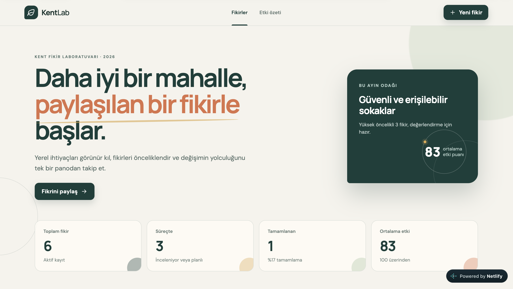
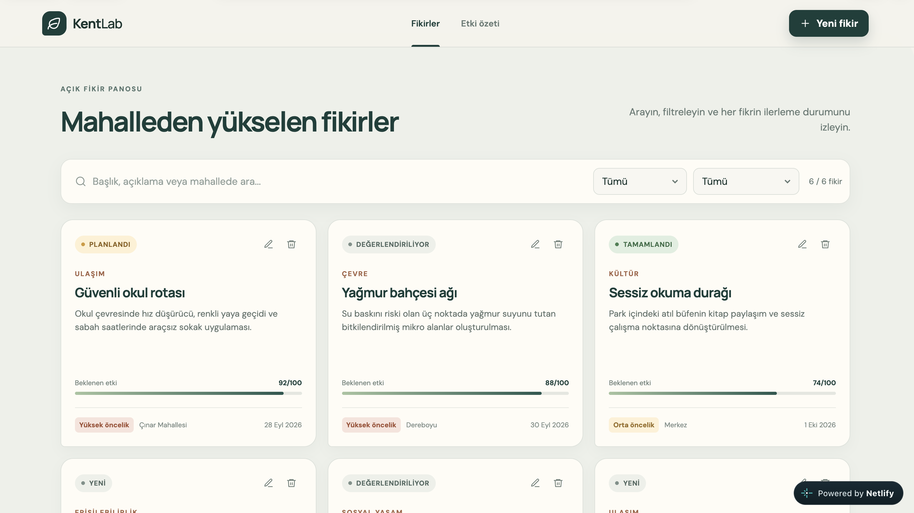
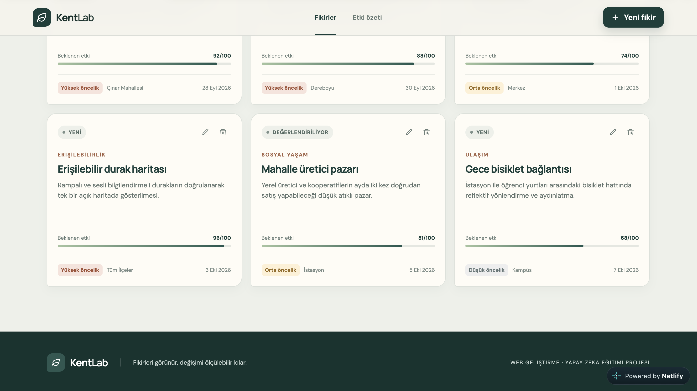
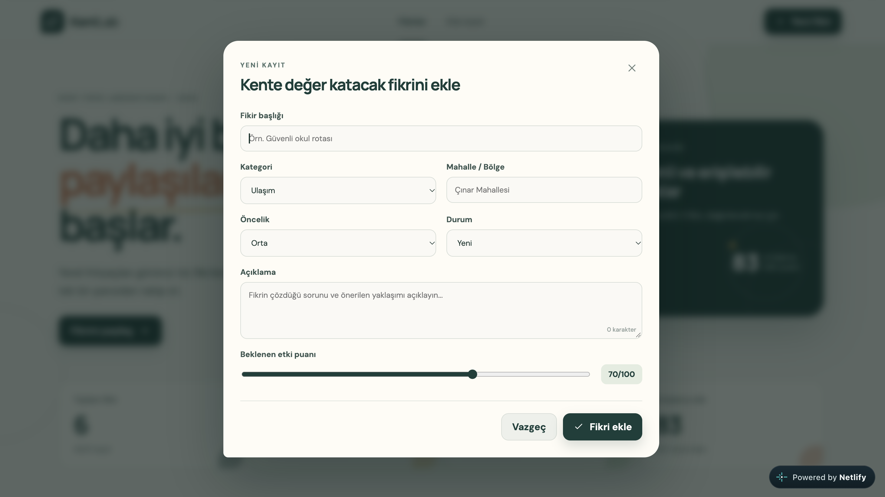

# KentLab - Kent İyileştirme Panosu

<p align="center">
  <strong>Mahalle fikirlerini görünür, ölçülebilir ve takip edilebilir hale getiren modern bir React uygulaması.</strong>
</p>

<p align="center">
  <a href="https://kentlab-iyilestirme-panosu.netlify.app"></a>
  
  
  
</p>

Kentlerde iyi fikirler çoğu zaman mesajlar ve belgeler arasında kaybolur. KentLab; önerileri tek yerde toplar, önceliklendirir, ilerleme durumunu izler ve beklenen etkiyi karar vericiler için anlaşılır bir özete dönüştürür.

<p align="center">
  <a href="https://kentlab-iyilestirme-panosu.netlify.app"><strong>Canlı uygulamayı aç</strong></a>
  ·
  <a href="docs/KentLab-4-Ekran-Goruntusu.pdf"><strong>4 ekranlık proje dosyası</strong></a>
</p>



## Neler yapabilirsiniz?

- Yeni kent fikri ekleme
- Kayıtları kart yapısında listeleme
- Mevcut fikri güncelleme
- Onay adımıyla güvenli silme
- Metin, kategori ve durum filtresi
- Canlı özet metrikleri ve etki puanı
- LocalStorage ile tarayıcıda kalıcı kayıt
- Klavye odağı, erişilebilir etiketler ve form doğrulama
- Masaüstü, tablet ve mobil uyumlu kullanım

## Uygulama galerisi

<p align="center">
  
  
</p>

<p align="center">
  
</p>

## Teknoloji ve mimari

- React 19 + TypeScript
- Vite üretim derlemesi
- Pure CSS tasarım sistemi
- LocalStorage veri katmanı
- Vitest otomatik testleri

```text
src/
├── components/   Yeniden kullanılabilir arayüz parçaları
├── data/         Örnek başlangıç verileri
├── interfaces/   TypeScript veri modelleri
├── pages/        Ana sayfa
└── utils/        Filtreleme, metrik ve depolama yardımcıları
```

## Yerel çalıştırma

```bash
npm install
npm run dev
```

Kalite kontrolleri:

```bash
npm test
npm run build
```

## Gizlilik ve yönerge uyumu

Kayıtlar bir sunucuya gönderilmez; yalnızca kullanılan tarayıcının LocalStorage alanında tutulur. React kullanımı, CRUD işlemleri, klasör mimarisi, CSS, LocalStorage, ekran görüntüsü ve yayınlanabilir üretim çıktısı `docs/YONERGE-UYUMU.md` içinde birebir eşleştirilmiştir.
