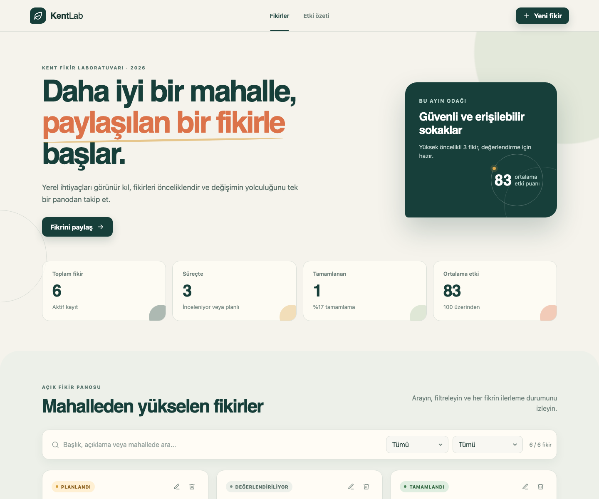

# KentLab — Kent İyileştirme Panosu

Mahallelerden gelen iyileştirme fikirlerini görünür, ölçülebilir ve takip edilebilir hale getiren modern bir React uygulaması.

**Canlı demo:** [kentlab-iyilestirme-panosu.netlify.app](https://kentlab-iyilestirme-panosu.netlify.app)

## Neden bu proje?

Kentlerde iyi fikirler çoğu zaman farklı mesajlarda veya belgelerde kaybolur. KentLab; fikirleri tek yerde toplar, önceliklendirir, durumlarını izler ve beklenen etkiyi karar vericiler için anlaşılır bir özete dönüştürür.

## Öne çıkan özellikler

- Yeni fikir ekleme
- Tüm fikirleri kart yapısında listeleme
- Mevcut fikirleri güncelleme
- Onay adımıyla güvenli silme
- Metin, kategori ve durum filtresi
- Canlı özet metrikleri ve etki puanı
- Tarayıcıda kalıcı kayıt (LocalStorage)
- Form doğrulama, klavye odağı ve erişilebilir etiketler
- Masaüstü, tablet ve mobil ekranlara uyumlu tasarım

## Kullanılan teknolojiler

- React 19
- TypeScript
- Vite
- Pure CSS
- LocalStorage
- Vitest

## Yerel çalıştırma

```bash
npm install
npm run dev
```

Tarayıcıda terminalde gösterilen yerel adresi açın. Üretim çıktısı için:

```bash
npm run build
npm run preview
```

Testler:

```bash
npm test
```

## Proje yapısı

```text
src/
├── components/   Yeniden kullanılabilir arayüz parçaları
├── data/         Örnek başlangıç verileri
├── interfaces/   TypeScript veri modelleri
├── pages/        Ana sayfa
└── utils/        Filtreleme, metrik ve depolama yardımcıları
```

## Veri gizliliği

Kayıtlar herhangi bir sunucuya gönderilmez. Yalnızca kullanılan tarayıcının LocalStorage alanında tutulur.

## Ekran görüntüsü



## Eğitim yönergesi uyumu

React kullanımı, CRUD işlemleri, klasör mimarisi, CSS, LocalStorage, ekran görüntüsü ve yayınlanabilir üretim çıktısı dahil tüm maddeler `docs/YONERGE-UYUMU.md` dosyasında eşleştirilmiştir.

## Proje sunumu için kısa anlatım

Sorun, çözüm, kullanıcı akışı ve teknik kararları içeren hazır anlatım `docs/PROJE-OZETI.md` dosyasındadır.
